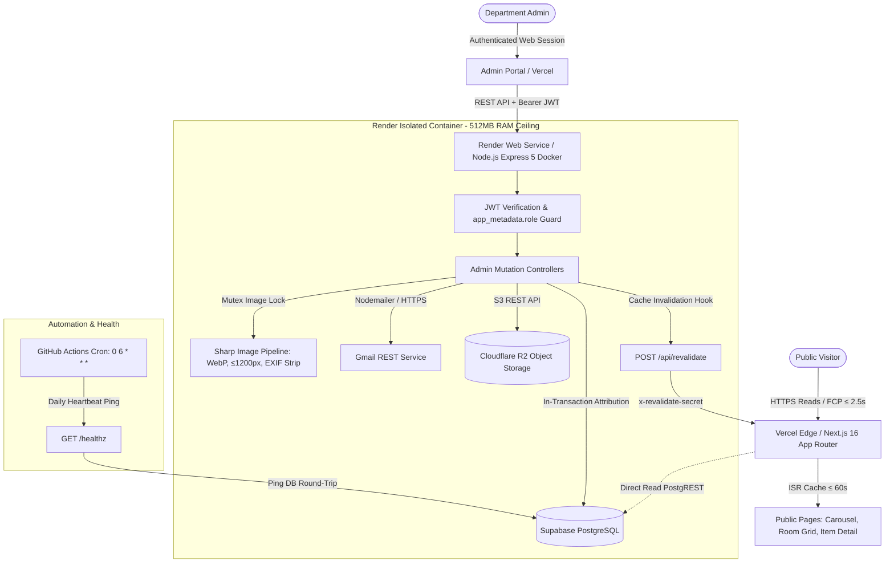

# ABU Smart Class Inventory

> **The Computer Engineering Smart Class inventory at Ahmadu Bello University — public to browse, private to manage, and engineered for COREN accreditation.**


---

## 📋 Table of Contents
- [System Architecture & Core Principles](#system-architecture--core-principles)
- [Key Features](#key-features)
- [Technology Stack](#technology-stack)
- [Repository Structure](#repository-structure)
- [Database & Data Isolation](#database--data-isolation)
- [Environment Configuration & Secrets](#environment-configuration--secrets)
- [Local Quick Start & Verification](#local-quick-start--verification)
- [Automated Testing & Pre-Flight Audits](#automated-testing--pre-flight-audits)
- [CI/CD & Deployment Guide](#cicd--deployment-guide)
- [Security & Compliance Red-Lines](#security--compliance-red-lines)
- [License & Support](#license--support)

---

## 🏗️ System Architecture & Core Principles

The **ABU Smart Class Inventory** replaces legacy spreadsheet equipment tracking with an enterprise-grade full-stack architecture adhering to strict edge-cache and backend isolation.



### Core Architecture Invariants

1. **Strict Read/Write Surface Isolation**: Public visitors never interact with the Render backend. All public browsing traffic is absorbed by Next.js Incremental Static Regeneration (ISR) with a 60-second revalidation ceiling.
2. **Zero Public Writes**: No public mutation endpoint exists anywhere. All data mutations require verified Supabase Auth JWT credentials with `app_metadata.role = 'admin'` and route exclusively through the isolated Node.js Express backend.
3. **In-Transaction Attribution**: Every item modification writes `updated_at = now()` and `updated_by = <admin_uuid>` atomically in the same database transaction. No unverifiable mutations can occur, guaranteeing COREN audit integrity.
4. **Resilient Dual Invalidation**: When an admin alters inventory, the backend pushes an immediate revalidation webhook to Next.js (`POST /api/revalidate`). If network transit fails, standard 60-second ISR time-based revalidation converges the cache automatically.
5. **Memory-Safe Image Pipeline**: Image processing is strictly mutex-serialized (`concurrency(1)`, `cache(false)`) inside the 512 MB Render memory envelope to prevent out-of-memory (OOM) failures under concurrent uploads.

---

## ⚡ Key Features

- **Public Showcase & Room Inventory**:
  - **Auto-Advancing Hero Carousel (S-001)**: Featuring Apple-grade kinetic touch/pointer tracking (`PointerVelocityTracker`), rubber-band soft bounds, momentum snapping, and automatic pause on hover/reduced-motion.
  - **Laboratory Register (S-002)**: Complete single-room specimen register enforcing the 15-item inventory ceiling with name-sorted records and zero-item fallback states.
  - **Item Detail Specimen View (S-003)**: High-resolution WebP image gallery with placeholder fallbacks, breadcrumbs, and COREN-aligned metadata tags.
- **Administrative Control & Governance**:
  - **Live Cold-Start Elapsed Panel (C-020)**: Gracefully handles Render free-tier container spin-ups with real-time second-by-second countdown and retry polling.
  - **4-State Condition Vocabulary**: Enforces strict domain enum validation (`Working`, `Faulty`, `Under Maintenance`, `Decommissioned`).
  - **Flat Admin Roster (S-008)**: Peer admin invitations using single-use SHA-256 token hashing and 8-character password floors.
  - **Last-Admin Safeguard (HTTP 409)**: Kernel-level protection preventing the deletion of the final administrator.
- **COREN Accreditation Export (S-010)**:
  - Instant streaming generation of formal engineering accreditation artifacts in **PDF (%PDF-1.4)** and **CSV (RFC 4180)**.
  - Enforces mandatory floor columns (`name`, `condition`, `quantity`, `updated_at`, `updated_by`) while withholding internal database UUIDs.
- **Automated Image Optimization (NFR-3)**:
  - Raw upload limit of 8 MB with magic-byte MIME sniffing (`image/jpeg`, `image/png`, `image/webp`, `image/avif`).
  - Automated EXIF metadata stripping, dimension clamping to ≤ 1200 px, and compression strictly under ≤ 150 KB mobile / ≤ 400 KB desktop budgets.

---

## 🛠️ Technology Stack

| Layer | Technologies | Role & Implementation Details |
|---|---|---|
| **Frontend UI** | Next.js 16.4.0 (App Router), React 19.3.0 | Static Generation, Incremental Static Regeneration (`revalidate = 60`), Server Components |
| **Styling & Motion** | Tailwind CSS 4.3.3, AASM-v1 Tokens | CSS Custom Properties, GPU-accelerated compositing (`transform`, `opacity`), fluid physics |
| **Components** | Radix UI Primitive Dialogs, Lucide Icons | Accessible headless primitives, focus trapping, semantic ARIA compliance |
| **Backend API** | Node.js 24+, Express 5.3.0, TypeScript 6.0 | REST API microservice running in an isolated Docker container on Render |
| **Image Processing**| Sharp (libvips) | Mutex-guarded transcode, resize, auto-contrast, WebP export, memory containment |
| **Database & Auth** | Supabase (PostgreSQL 15+, GoTrue Auth) | Row Level Security (RLS), HMAC-SHA256 JWT validation, argon2id password hashing |
| **Object Storage**  | Cloudflare R2 | S3-compatible public bucket for processed image assets with 0 egress cost |
| **Email Transport** | Nodemailer 10.1.2 via Gmail REST API | Admin invitation dispatches over HTTPS (bypasses Render SMTP port blocks) |
| **Testing Harness** | Vitest 5.0.4, JSDOM, React Testing Library | 61 test suites, 1,116 automated unit, contract, accessibility, and adversarial tests |
| **CI/CD & Cron**    | GitHub Actions, Docker | 4-stage pipeline (Lint, Test, Build, Docker Build) + daily 06:00 UTC database heartbeat |

---

## 📁 Repository Structure

```
ABU SmartComp/
├── .github/
│   └── workflows/
│       ├── ci.yml                 # 4-stage CI/CD pipeline (lint, test, build, docker)
│       └── heartbeat.yml          # Daily 06:00 UTC Supabase active keep-alive
├── app/                           # Next.js App Router (Public & Admin interfaces)
│   ├── _components/               # Core design system components (buttons, dialogs, cards)
│   ├── admin/                     # Private admin portal (register, items, admins, login)
│   ├── api/revalidate/            # Inbound cache revalidation webhook
│   ├── item/[id]/                 # Specimen detail view
│   ├── privacy/                   # NDPA 2023 statutory privacy notice
│   ├── room/                      # Complete laboratory inventory register
│   ├── globals.css                # Scoped Tailwind directives & theme variables
│   ├── layout.tsx                 # Root layout with single SkipLink mounting
│   ├── page.tsx                   # Landing page with kinetic carousel
│   └── tokens.css                 # AASM-v1 design token authority
├── backend/                       # Isolated Express 5 backend service
│   ├── migrations/                # Versioned SQL database migrations (0001 - 0007)
│   ├── src/
│   │   ├── routes/                # Express controllers (items, admins, health)
│   │   ├── audit-images.ts        # Image audit compliance engine
│   │   ├── auth.ts                # Server-side JWT verification & role validation
│   │   ├── db.ts                  # Supabase client & transactional data access
│   │   ├── image-pipeline.ts      # Mutex-locked Sharp image transcode engine
│   │   ├── legacy-import.ts       # Legacy spreadsheet & zip ingestion tooling
│   │   ├── mailer.ts              # Gmail HTTPS email invitation transport
│   │   ├── revalidate.ts          # Outbound Next.js ISR revalidation dispatcher
│   │   ├── server.ts              # Express application lifecycle & error handlers
│   │   └── storage.ts             # Cloudflare R2 client integration
│   ├── Dockerfile                 # Multi-stage production container build (Alpine Linux)
│   └── package.json               # Backend workspace dependencies
├── design/                        # Design System v1.0.0 handoff & specifications
├── docs/                          # Engineering documentation suite
│   ├── PROJECT_SUMMARY.md         # Identity, problem statement, constraints
│   ├── PRD.md                     # Product Requirements Document
│   ├── TRD.md                     # Technical Requirements Document
│   ├── ARCHITECTURE_BACKEND.md    # Express runtime & data isolation
│   ├── SECURITY.md                # Threat modeling & security controls
│   ├── CICD.md                    # Pipeline specifications & smoke tests
│   └── RELEASE_EVIDENCE.md        # Session S-07 verification verdict (100% PASS)
├── lib/                           # Shared utility libraries
│   ├── admin-api.ts               # Administrative REST client
│   ├── admin-auth.ts              # Client-side session & JWT management
│   ├── equipment.ts               # PostgREST data fetcher with last-known-good cache
│   ├── fluid-physics.ts           # Spring physics & velocity tracking algorithms
│   └── supabase.ts                # Public Supabase client configuration
├── scripts/                       # Pre-flight compliance & verification tools
│   ├── check-css-clean.mjs        # Production stylesheet hygiene checker
│   ├── check-migrations.mjs       # Database migration sequence & pair validator
│   ├── check-motion-allowlist.mjs # GPU-composited CSS animation validator
│   ├── check-raw-tokens.mjs       # Zero-raw-token design enforcement
│   └── verify_apple_design.py     # Optical tracking & typography verifier
├── tests/                         # Comprehensive test harness (1,116 tests)
├── package.json                   # Root monorepo workspace configuration
└── .env.template                  # Environment template and variable declarations
```

---

## 🛢️ Database & Data Isolation

Database persistence is managed by **Supabase PostgreSQL 15+** with complete **Row Level Security (RLS)** active across all tables.

### Database Schema Overview

```
equipment
├── id: uuid (PK, default gen_random_uuid())
├── name: text (NOT NULL)
├── slug: text (UNIQUE, NOT NULL)
├── core_functionality: text
├── other_functionality: text
├── condition: equipment_condition ('Working' | 'Faulty' | 'Under Maintenance' | 'Decommissioned')
├── quantity: integer (DEFAULT 1, CHECK quantity >= 1)
├── image_keys: text[] (Cloudflare R2 keys)
├── created_at: timestamptz (DEFAULT now())
├── updated_at: timestamptz (Attribution write on every mutation)
└── updated_by: uuid (FK → admins.id)

admins
├── id: uuid (PK, FK → auth.users.id)
├── name: text
├── email: text (UNIQUE, NOT NULL)
└── created_at: timestamptz (DEFAULT now())

admin_invites
├── id: uuid (PK, default gen_random_uuid())
├── email: text (UNIQUE where accepted_at IS NULL)
├── token_hash: text (NOT NULL, SHA-256 digest of emailed token)
├── invited_by: uuid (FK → admins.id)
├── created_at: timestamptz (DEFAULT now())
└── accepted_at: timestamptz (NULL until accepted)

audit_log
├── id: uuid (PK, default gen_random_uuid())
├── actor_admin_id: uuid (FK → admins.id)
├── action: text ('admin.invite' | 'admin.accept' | 'admin.remove')
├── target: text (Subject email)
└── created_at: timestamptz (DEFAULT now())
```

### Row Level Security (RLS) Matrix

| Table | Anonymous (`anon`) | Authenticated (`admin`) | Service Role (Backend) |
|---|:---:|:---:|:---:|
| `equipment` | `SELECT` Only | `SELECT`, `INSERT`, `UPDATE`, `DELETE` | Full Access |
| `admins` | Blocked | `SELECT`, `DELETE` (Guarded) | Full Provisioning |
| `admin_invites` | Blocked | `SELECT` | `INSERT`, `UPDATE` |
| `audit_log` | Blocked | `SELECT`, `INSERT` | Append-Only `INSERT` |

*Note: All updates and deletes are permanently revoked from `audit_log` across all roles for non-repudiation.*

---

## 🔑 Environment Configuration & Secrets

Copy `.env.template` to `.env` to configure local or deployment environments:

```bash
cp .env.template .env
```

### Environment Variable Reference

```ini
# ==============================================================================
# 1. FRONTEND / VERCEL (Public & Serverless Edge)
# ==============================================================================
SUPABASE_URL=https://<project-ref>.supabase.co
SUPABASE_ANON_KEY=eyJhbGciOi...
NEXT_PUBLIC_SUPABASE_URL=https://<project-ref>.supabase.co
NEXT_PUBLIC_SUPABASE_ANON_KEY=eyJhbGciOi...
NEXT_PUBLIC_RENDER_SERVICE_URL=https://abu-smartcomp-api.onrender.com
NEXT_PUBLIC_R2_PUBLIC_URL=https://assets.smartcomp.abu.edu.ng
REVALIDATE_SECRET=32-byte-hex-random-token

# ==============================================================================
# 2. BACKEND / RENDER (Private Server Secrets - NEVER EXPOSE TO CLIENT)
# ==============================================================================
PORT=3001
SUPABASE_SERVICE_ROLE_KEY=eyJhbGciOi...
SUPABASE_JWT_SECRET=super-secret-jwt-signing-key
FRONTEND_URL=https://smartcomp.abu.edu.ng
R2_ACCOUNT_ID=cloudflare-account-id
R2_ACCESS_KEY_ID=r2-access-key-id
R2_SECRET_ACCESS_KEY=r2-secret-access-key
R2_BUCKET_NAME=abu-smartcomp-images

# ==============================================================================
# 3. GMAIL DELIVERY (App Password for HTTPS Transport)
# ==============================================================================
GMAIL_USER=smartcomp-admin@abu.edu.ng
GMAIL_APP_PASSWORD=xxxx-xxxx-xxxx-xxxx

# ==============================================================================
# 4. OPTIONAL TESTING SIMULATION TOGGLES
# ==============================================================================
# SIMULATE_R2_FAILURE=false
# SIMULATE_GMAIL_FAILURE=false
# SIMULATE_EXPORT_FAILURE=false
```

---

## 🚀 Local Quick Start & Verification

### 1. Prerequisites
- **Node.js**: v24.0.0 or higher
- **npm**: v10.0.0 or higher
- **Docker**: Optional (required only for local container verification)

### 2. Dependency Installation
Install dependencies across both root and backend workspaces:

```bash
npm ci
```

### 3. Database Migration Setup
Apply the 7 versioned SQL migrations in sequential order against your Supabase project using the Supabase CLI or SQL Query Editor:

```bash
# Verify migration integrity
node scripts/check-migrations.mjs
```

### 4. Running the Application Locally

In two separate terminal sessions:

```bash
# Terminal 1: Launch Backend Express Service (Port 3001)
npm run build --workspace backend
npm run start --workspace backend

# Terminal 2: Launch Frontend Next.js Server (Port 3000)
npx next dev
```

Visit `http://localhost:3000` to browse the public inventory, or `http://localhost:3000/admin` to access the administration portal.

---

## 🧪 Automated Testing & Pre-Flight Audits

The codebase enforces strict continuous verification across unit, contract, integration, and security boundaries.

### Execute Full Test Suite

```bash
# Run Vitest across all 61 test files (1,116 tests)
npm.cmd test
```

### Run Static Analysis & Quality Audits

The lint pipeline executes a comprehensive battery of static verifiers:

```bash
# Runs Prettier check, ESLint, motion allowlist, token verifier, and migration checker
npm.cmd run lint
```

### Pre-Flight Verification Breakdown

- **Migration Checker (`scripts/check-migrations.mjs`)**: Verifies matching `.up.sql` and `.down.sql` pairs, gap-free version sequences, and zero unresolved TBD comments.
- **Raw Token Checker (`scripts/check-raw-tokens.mjs`)**: Asserts that no raw CSS values or arbitrary pixel overrides bypass the AASM-v1 token definitions.
- **Motion Allowlist Checker (`scripts/check-motion-allowlist.mjs`)**: Validates that all CSS animations are strictly GPU-composited (`transform`, `opacity`) and honor `prefers-reduced-motion`.
- **Clean CSS Checker (`scripts/check-css-clean.mjs`)**: Asserts production CSS builds contain no dead classes or invalid utility patterns.
- **Apple Design Standards (`scripts/verify_apple_design.py`)**: Checks optical negative tracking on headers (`--tracking-h1`, `--tracking-h2`) and capital tracking on chips.

---

## 🚢 CI/CD & Deployment Guide

Deployment is orchestrated via GitHub Actions and cloud native integrations:

### 1. Continuous Integration Pipeline (`.github/workflows/ci.yml`)
- **Stage 1 (Lint)**: Validates code format, ESLint, migration schemas, and design token integrity.
- **Stage 2 (Test)**: Executes all 1,116 Vitest test suites.
- **Stage 3 (Build)**: Compiles the Next.js production bundle and builds the backend multi-stage Alpine Docker container (`docker build -f backend/Dockerfile .`).
- **Stage 4 (Deploy Smoke Checks)**: Executes live HTTPS smoke probes against Render `/healthz` and Vercel `/` upon merge to `main`.

### 2. Availability Heartbeat (`.github/workflows/heartbeat.yml`)
- Runs daily at `06:00 UTC` (`0 6 * * *`).
- Dispatches a 15-second probe to `https://<render-url>/healthz`.
- Ensures the Supabase free-tier database does not pause due to 7 days of inactivity (I9 invariant).

### 3. Production Deployment Topography
- **Vercel**: Deploy the root repository as a Next.js application. Configure the environment variables specified in Section 1 of `.env.template`.
- **Render**: Deploy `backend/Dockerfile` as a Web Service on the Free tier. Configure the environment variables specified in Section 2 & 3 of `.env.template`.

---

## 🔒 Security & Compliance Red-Lines

> [!CAUTION]
> **STRICT COMPLIANCE DIRECTIVES & SECURITY BOUNDARIES**
> 
> 1. **Zero Secret Leakage**: Under no circumstances should `SUPABASE_SERVICE_ROLE_KEY`, `R2_*`, `GMAIL_*`, or `SUPABASE_JWT_SECRET` be exposed to the client bundle or committed to version control.
> 2. **NDPA 2023 Compliance**: The application collects only administrator names and institutional email addresses. No visitor tracking, analytics beacons, or third-party cookies are used. The statutory privacy notice is accessible at `/privacy`.
> 3. **Timing-Safe Cache Invalidation**: The `/api/revalidate` endpoint evaluates `x-revalidate-secret` using pre-hashed SHA-256 buffers compared via `crypto.timingSafeEqual` to prevent side-channel timing attacks.
> 4. **Last-Admin Immutability**: The backend rejects any attempt to delete the final administrator with HTTP 409 (`last-admin`).
> 5. **Image Memory Bounds**: Uploaded images are restricted to 8 MB, verified via magic-byte header inspection, and processed through a mutex-locked queue to maintain a strict ≤ 512 MB peak RSS footprint.

---

## 📄 License & Support

Distributed under the **MIT License**. Maintained by the **Department of Computer Engineering, Faculty of Engineering, Ahmadu Bello University (ABU), Zaria, Nigeria**.

For accreditation inquiries, technical bug reports, or COREN audit verification, please open an issue in the official departmental repository.
